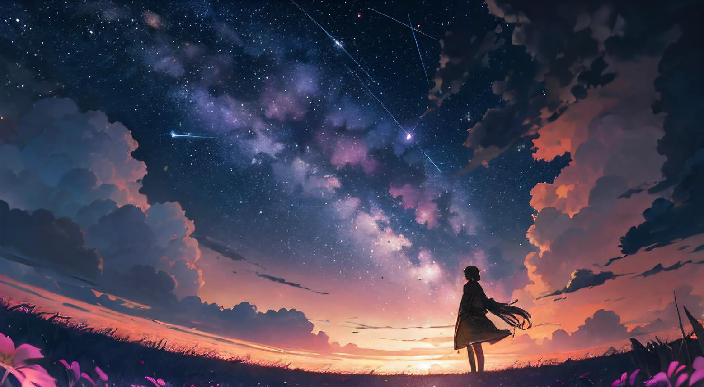
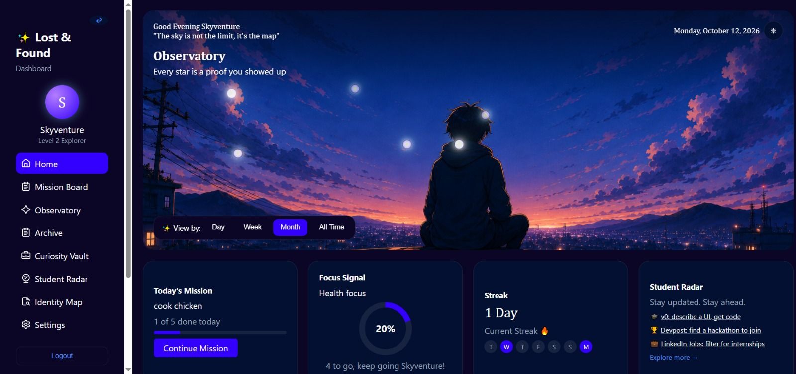
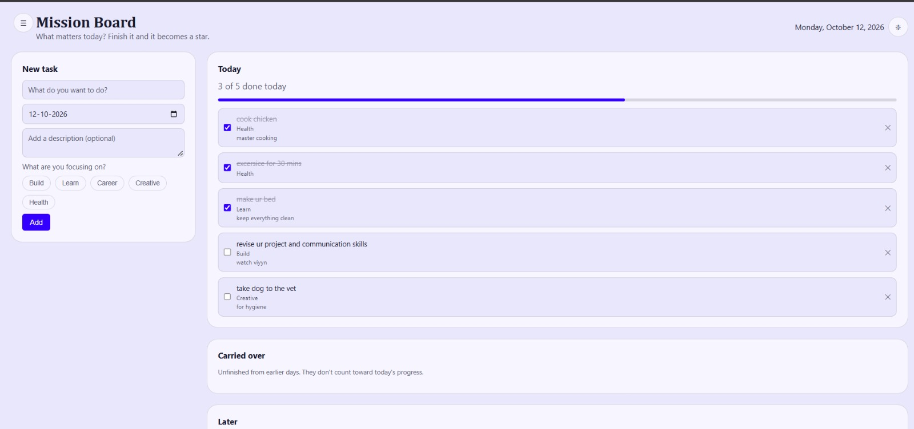
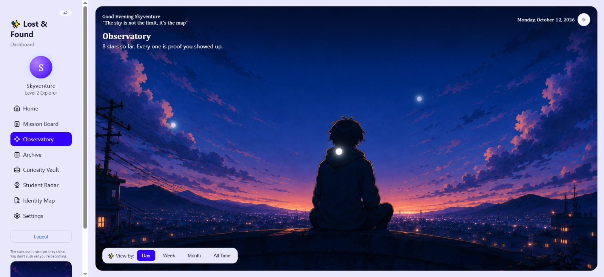
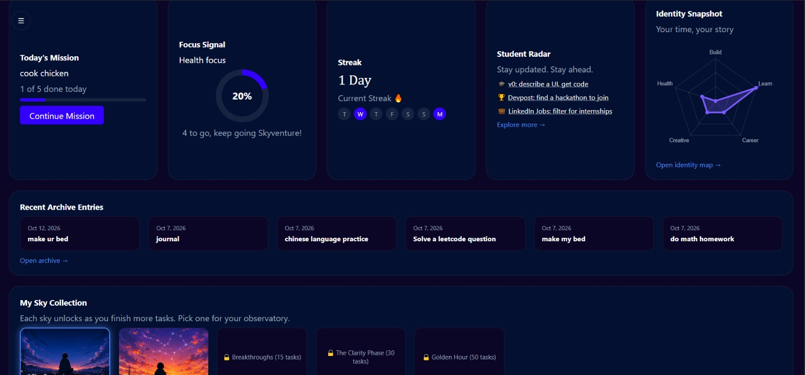

# ✨ Lost & Found

*A personal dashboard for finding your rhythm, one small accomplishment at a time.*
# Lost & Found

🌐 **[Live Demo](https://flockstock.github.io/Lost-Found-Dashboard/)**

A personal dashboard for organising tasks, learning, career goals, and creative projects.
Lost & Found began with a simple idea: **what if the things we accomplish every day could become something we could actually see?**

It's easy to move through a day, finish a few things, and still feel like we haven't made much progress. Lost & Found turns those small efforts into something tangible. Every completed task becomes a star. Over time, those stars build streaks, reveal patterns in what you do, and gradually fill your own little observatory.

And somewhere along the way, the dashboard starts to feel like yours.

## The idea behind it

Lost & Found brings together everyday planning, personal progress, and a little sense of wonder.

Instead of treating tasks as items to cross off and forget, it gives them a place in a bigger picture. Learning something new, working on a project, exploring a creative interest, or taking a step towards a career goal all become part of your growing sky.

The goal isn't to turn every moment into a competition. It's to make progress easier to notice, appreciate, and return to.

## Your day, becoming a sky

- **Make your missions.** Keep track of what matters today, what you've carried over, and what's waiting for later.
- **Collect your stars.** Every completed task adds a star to your observatory, marking the work you've done.
- **Find your rhythm.** Streaks and daily progress help you notice consistency, even when the steps are small.
- **Discover your patterns.** Explore your completed tasks through focus areas, daily archives, and your identity map.
- **Choose your sky.** Unlock new skies as you complete more tasks. Choose the one that feels right, and make it the backdrop of your dashboard.
- **Make it your own.** Personalise your display name and switch between light and dark themes.

Your progress isn't just a number on a screen. It's a record of the time and effort you've put into yourself.
## Preview

### Your personal dashboard

### Plan your day

### Your growing observatory

### Choose your sky

## A little observatory of your own

The Sky Collection is at the heart of Lost & Found's personality.

As you complete tasks, new skies become available to discover. Selecting one changes the dashboard's hero background, and your choice stays saved to your profile.

It's a small detail, but an important one: the place where you track your progress should gradually reflect the person making it.

## More than a task list

Lost & Found connects a few simple ideas:

**Plan → Do → Reflect → Discover → Personalise**

Your tasks create progress. Your progress builds your observatory. Your history reveals your patterns. And the sky you choose makes the experience feel personal.

The result is a visual space for organising everyday life while making room for curiosity, creativity, learning, and growth.

## Built with

- HTML, CSS, and vanilla JavaScript
- Supabase for authentication and data storage
- Chart.js for the Student Radar visualisation

The project uses a simple static-site structure with no build step.

## Explore the project

- [Project requirements](REQUIREMENTS.md) — the original purpose, expected behaviour, and scope.
- [Contributing guide](CONTRIBUTING.md) — setup instructions and how to contribute.

## A final thought

Lost & Found is built around the belief that small efforts still count, even when they don't feel significant at the time.

You might not notice a whole sky changing in a day. But one star at a time, it does.

